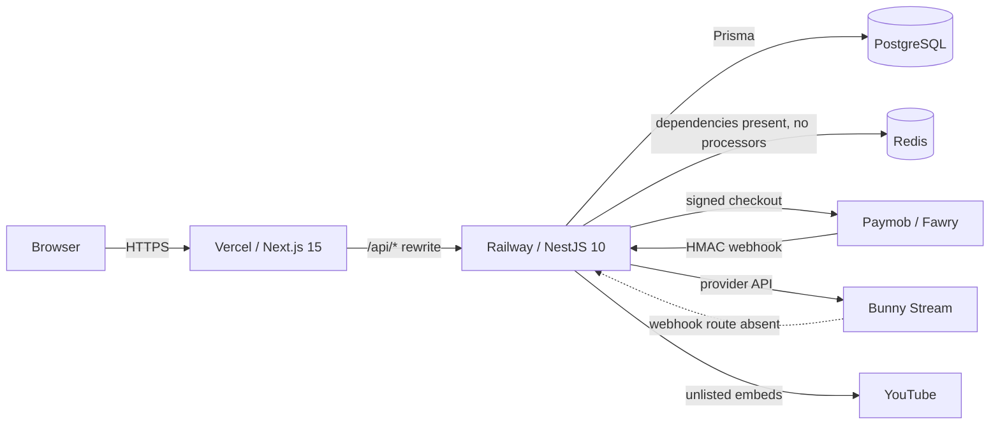

<div align="center">

# SANAD Learning Platform

**A multi-tenant learning platform for Egyptian teachers — one codebase, many branded teacher spaces.**

[](https://nextjs.org/)
[](https://nestjs.com/)
[](https://www.postgresql.org/)
[](https://www.prisma.io/)
[](LICENSE)

[Live demo](https://sanad-edtech.vercel.app) · [Current state](docs/CURRENT-STATE.md) · [Architecture](docs/ARCHITECTURE.md) · [Security](docs/SECURITY.md)

</div>

---

## Live demo

| Surface | URL |
| --- | --- |
| Student / teacher web app | <https://sanad-edtech.vercel.app> |
| API health through the web domain | <https://sanad-edtech.vercel.app/api/health> |
| API health, direct Railway origin | <https://sanad-edtech-production.up.railway.app/api/health> |

The production database is seeded with the `sanad-demo` tenant and three published Arabic prep courses.

| Role | Phone | Password |
| --- | --- | --- |
| Teacher | `01000000001` | `Joker-Arabic#2026` |
| Student | `01000000002` | `Student123!` |

These are **demo accounts**. Never reuse demo credentials for a real tenant.

Production is `main`; the verified app release is `4951e49`. Documentation-only commits after it do not change runtime code. The last verified production run: **311/311 API tests, 137/137 web tests, 4/4 build tasks**, and both health endpoints returning `200` with the database up. Full evidence: [`docs/CURRENT-STATE.md`](docs/CURRENT-STATE.md).

A pending hardening branch, `feat/security-quick-wins`, adds per-IP/auth rate limiting, server-side lock enforcement, and authoring-read bypass fixes. Its local evidence is **344/344 API tests (34 suites), 137/137 web tests, 4/4 build tasks**, plus a live local login-limit smoke. It is **not deployed** yet; production remains `4951e49`.

The `feat/assignment-retakes` branch (hardening merged) adds a real attempt model (migration #8), server-side `maxAttempts`, active-before-max ordering, and retake-aware student/teacher UI. Its local evidence is **353/353 API tests (34 suites), 145/145 web tests, 4/4 build tasks**, an **8/8** fresh migration chain, retake plus concurrent-start HTTP smokes, and browser QA for active retakes and locked assignments. Migration #8 has **not** been applied to Railway; the read-only preflight passed and a backup is still required.

---

## What this is

SANAD is a **multi-tenant, white-label LMS** built for the way Egyptian teachers actually work:

- a teacher gets a branded space, courses, students, payments, and analytics without a code fork;
- a student gets a curriculum, lessons, assignments, exams, progress, and a personal dashboard;
- the operator gets one deployable core with tenant isolation, audit trails, and a single migration history.

It is not a marketplace and not a collection of unrelated demo pages. The shipped loop is real: teacher authoring → published course → student curriculum → lesson → assignment/exam → grading → progression → payments.

---

## Current state — verified 25 October 2026

### Shipped and exercised

| Area | What exists now |
| --- | --- |
| Tenancy | Host-based tenant resolution via `tenant_domains`; the production host resolves `sanad-demo` |
| Auth | JWT access cookie (15 min) + rotating opaque refresh cookie; session restore on hard reload; logout revokes the refresh family |
| Teacher authoring | Courses, sections, lessons, resources, assignments, exams, publish/unpublish/archive, course builder and publish workspace |
| Student curriculum | Course detail with section/lesson/task breakdown, progress, available/locked tasks, and direct links into each task |
| Lesson workspace | Video, exam brief, assignment brief, locked-video prerequisite state, responsive RTL layouts |
| Timers | Server-authoritative assignment timer (300 minutes) and exam timer (70 minutes); refresh does not reset the derived expiry |
| Progression | Per-student `ENTER_ASSIGNMENT` → linked exam unlock, `ENTER_EXAM` → next lesson unlock; idempotent grants |
| Grading | Teacher exam grading queue and assignment submission review |
| Student dashboard | `/student` Command Center; all numbers derive from server payloads |
| Payments | Paymob, Fawry, and voucher checkout; signed webhooks; idempotency; ledger; entitlements; refunds |
| Refunds | Admin-only, idempotent, CAS transitions, ledger reversal, surgical entitlement revocation |
| Video | Bunny Stream provider code; unlisted YouTube attach path used by the demo; signed playback token + watermark primitives |
| Themes | Dark by default; Academic Light Mode (“Heritage Manuscript”) across student surfaces; pre-paint `localStorage` restore |
| Deployment | Vercel web + Railway API/PostgreSQL; root Dockerfile for the API; Vercel `/api/*` rewrite to Railway |

### Implemented but not active in production

| Area | Why it is not “done” |
| --- | --- |
| PostgreSQL RLS | 138 policies exist across all 43 application tables and tenant context is injected per request. The runtime still connects with owner/superuser credentials, so RLS is **not enforcing on Railway** yet. |
| Outbox | `OutboxEvent` rows are written atomically with business changes, but no dispatcher/relay delivers them. |
| Background jobs | Redis/Bull dependencies are installed; no processors are registered. |
| Video webhook | No HTTP route exposes the provider webhook. |
| Reconciliation | Models exist; no live reconciliation worker or route. |
| Advanced progression | Only `ENTER_ASSIGNMENT` and `ENTER_EXAM` are active. Other unlock types are extension points. |
| Rate limiting + lock enforcement | Implemented on `feat/security-quick-wins`, not deployed: global per-IP limits, stricter login/register/refresh limits, metadata-only locked lessons, and 403 responses from locked assessment endpoints. The throttler uses in-memory storage per API instance. |
| Assignment retakes | Implemented on the stacked `feat/assignment-retakes` branch, not deployed: `IN_PROGRESS`, per-attempt rows, server-side `maxAttempts`, and migration #8. Production still has one submission row per student/assignment. |
| Word-level review evidence | Submissions store `content`, `score`, and `feedback`; per-word evidence spans are not persisted. |
| Provider sandbox proof | Paymob/Fawry integration code and local webhook smokes exist; a real provider sandbox run is still pending. |

Read [`docs/CURRENT-STATE.md`](docs/CURRENT-STATE.md) before making a claim about any of these. It is the canonical snapshot.

---

## Architecture



### Request lifecycle

1. Browser calls the web app on the same origin.
2. Next.js serves the page and rewrites `/api/*` to the API origin.
3. `TenantResolverMiddleware` resolves the host to a tenant through a `SECURITY DEFINER` lookup.
4. The request enters an `AsyncLocalStorage` tenant scope.
5. `JwtAuthGuard` authenticates the HttpOnly access cookie; `AuthorizationGuard` + `@RequirePermission` enforce RBAC.
6. `PrismaService` calls `set_config('app.tenant_id', ..., true)` inside a short transaction before each operation.
7. RLS policies are ready to enforce isolation — but only once the runtime URL points at `app_user` and the service preference is flipped.
8. Domain services write business state, audit rows, and outbox events in the same transaction where required.

### Repository layout

```text
learning-platform/
├── apps/
│   ├── api/                     NestJS API, Prisma schema, migrations, seeds
│   └── web/                     Next.js 15 App Router client
├── packages/
│   ├── design-system/           tokens.css + token sources
│   └── motion/                  shared motion tokens
├── docs/                        current state, architecture, security, deployment, design
├── docker/postgres/init/        local app_user bootstrap
├── scripts/                     dev/port helpers
├── Dockerfile                   Railway API build
├── railway.json                 Railway builder config
├── docker-compose.yml           local PostgreSQL 15 + Redis 7
└── turbo.json
```

There is no root `tsconfig.base.json`. Each workspace owns its TypeScript config.

---

## Multi-tenancy and RLS

### What is implemented

- `TenantDomain` maps hostnames to tenants; `TenantResolverMiddleware` resolves the request host.
- `runWithTenantId()` stores the tenant in `AsyncLocalStorage`.
- `PrismaService` injects `app.tenant_id` for every operation.
- Interactive transactions call `applyTenantContext(tx)` explicitly.
- The migrations install policies on all **43** application tables, including `student_lesson_unlocks` (the 43rd table).
- `app_user` is a non-owner, non-superuser role created by the local Docker bootstrap and by the RLS hardening migration (behind a superuser check).

### What is still required

RLS is not a production control until the API connects as `app_user`. Today `apps/api/src/modules/tenants/prisma.service.ts` chooses `MIGRATION_DATABASE_URL` before `DATABASE_URL`, and the deployed service uses the migration/owner URL.

To activate:

1. Rotate the Railway database password by hand.
2. Apply all migrations as the migration owner (7 in production; 8 once the retakes branch is merged).
3. Set the runtime `DATABASE_URL` to the `app_user` connection string.
4. Remove `MIGRATION_DATABASE_URL` from the runtime environment.
5. Flip the preference in `prisma.service.ts` to `DATABASE_URL` first.
6. Re-run `apps/api/test/rls-isolation.e2e-spec.ts` against the deployed role.

Until then, **every query must still carry `tenantId`**. Application filters are the active isolation control.

---

## LMS core

### Course model

`Course → Section → Lesson → Resource`, with lesson types for video, exam, and assignment. Publishing changes the current row; the schema does **not** yet have a separate course/lesson/exam version table, so do not claim immutable publish snapshots.

### Assignment timer

- Default duration: **300 minutes** (configurable per assignment, maximum 10,080).
- Start (pending retakes branch): the API creates an `IN_PROGRESS` `AssignmentSubmission` with a server-set `startedAt` and `submittedAt = null`.
- Expiry: derived as `startedAt + timerMinutes`; it is not stored as a separate column.
- The frontend displays the derived remaining time only; it never owns it.
- Refresh or browser restart does not reset the timer; re-entering resumes the same active row.
- Submitting sets `submittedAt` and the final status: `SUBMITTED` on time, `LATE` when allowed, or `REJECTED` when not; grading writes `GRADED`/`RETURNED`.
- Each attempt is unique on `(assignmentId, studentId, attemptNumber)`, and `maxAttempts` is enforced server-side. A concurrent duplicate start returns `409`.
- In-progress attempts are excluded from teacher grading; the student history includes them with `submittedAt: null`.
- Production `4951e49` still uses the old one-row model, where `submittedAt` is the timer start and `maxAttempts` does not enable retakes.

### Exam timer

- Default duration: **70 minutes** (4,200 seconds).
- `expiresAt` is derived from `startedAt + timerMinutes`; there is no stored `expiresAt` column on `ExamAttempt`.
- The student client auto-submits when the timer reaches zero; the API records a late submit as `TIMED_OUT`. There is no background auto-submit worker.
- Question types: MCQ, true/false, short answer, essay, matching.
- Correct answers are never exposed in the student view.

### Progression by entry

The active rules are deliberately simple:

```text
ENTER_ASSIGNMENT → unlock the linked exam lesson
ENTER_EXAM       → unlock the next lesson
```

No score threshold is required. Grants are stored per student in `student_lesson_unlocks` with a unique `(tenantId, userId, lessonId)` constraint, written inside one transaction with `createMany + skipDuplicates`. Retries are idempotent.

Future unlock types (`COMPLETE_*`, `PASS_EXAM`, `SCORE_THRESHOLD`, `TIME_ELAPSED`, manual) are not active. On production `4951e49` the lock is still advisory in some student API views. The pending `feat/security-quick-wins` branch redacts video/assessment payloads from locked lessons and rejects locked assessment views/entries unless the student has a grant. See the known-limits table in [`docs/CURRENT-STATE.md`](docs/CURRENT-STATE.md).

---

## Student experience

The student surfaces were redesigned in October 2026 around the **Heritage Manuscript** language:

- warm parchment/ink light mode and graphite dark mode;
- emerald as the single action accent;
- Arabic-first RTL typography with matched Latin fallbacks;
- a curriculum board that reads like a table of contents, not a card grid;
- a lesson workspace built around the actual task: video, exam brief, or assignment brief;
- clear locked/unlocked states and direct task links;
- responsive layouts verified at desktop and mobile widths in both themes.

Key routes:

| Route | Purpose |
| --- | --- |
| `/student` | Command Center |
| `/student/courses` | Enrolled courses |
| `/student/courses/[id]` | Curriculum board |
| `/student/lessons/[id]` | Lesson workspace |
| `/student/assignments` | Assignment list |
| `/student/assignments/[id]` | Assignment runner/result |
| `/student/exams` | Exam list |
| `/student/exams/[id]` | Exam runner |
| `/student/profile` | Student profile |

Teacher routes cover the dashboard, courses, builder, preview, publish workspace, lessons, assignments, exams, grading, analytics, students, payments, and settings.

### Theme

- Default: dark.
- Toggle: student dock (Moon/Sun).
- Stored key: `sanad:theme`.
- Applied before paint by the inline bootstrap in `apps/web/app/layout.tsx`.
- All light rules are scoped under `html[data-theme="light"]` in `apps/web/app/globals.css`.

### Session restore

A hard reload used to empty the in-memory access token and silently log the user out. `AuthProvider` now restores on mount:

1. `POST /api/auth/refresh` using the HttpOnly refresh cookie;
2. `GET /api/users/me` with the new access token;
3. render protected pages only after `ready` is true.

Logout calls `POST /api/auth/logout` first so the next reload cannot resurrect the session.

---

## Payments

```text
Order → PaymentIntent → Provider → Payment → LedgerEntry → Entitlement
```

### Implemented providers

| Provider | Status |
| --- | --- |
| Paymob | Implemented, HMAC-SHA512 verification, hosted checkout fields |
| Fawry | Implemented, secure-hash verification |
| Voucher | Internal, atomic redemption with unique redemption per user |
| Instapay | Scaffolding/stub — not a live payment method |
| Vodafone Cash | Scaffolding/stub — not a live payment method |
| e&money | Scaffolding/stub — not a live payment method |

### Money rules

- Money leaves the API as JSON **strings**; `BigInt` serialization is patched globally.
- Pricing is canonicalized in minor units with `toBigIntMinor`.
- Every financial mutation has an idempotency key; retries replay the stored response.
- Webhooks verify the signature **before** any state change and retain the raw payload for replay.
- A completed payment, ledger entries, entitlement, order status, and idempotency completion happen in one transaction.
- A paid callback with no matching `PROCESSING` intent fails visibly as `INTENT_NOT_FOUND` and is retryable.
- A second paid transaction for an already-settled order raises `SECOND_CHARGE_DETECTED` with HIGH severity; it is not auto-settled.

### Refunds

- `POST /payments/:paymentId/refunds`, admin-only, mandatory `idempotencyKey`, optional `amountMinor`.
- The idempotency key is claimed before validation so a replay after completion still replays the response.
- Only the CAS claim and the settlement CAS are money guards.
- Settlement reverses ledger entries, marks the payment/order refunded, revokes the matching entitlement, and restores voucher redemption in one transaction.
- Partial refunds keep access.
- Paymob `is_refunded`/`is_voided` are classified before `success`; provider rejection is retryable.

---

## Video

| Path | Reality |
| --- | --- |
| Bunny Stream | Provider implementation for upload/signing/status; requires `BUNNY_STREAM_*` env vars |
| VdoCipher | Explicit stub; not usable |
| YouTube unlisted | Teacher attaches an unlisted video id; the student player uses the YouTube IFrame API with `youtube-nocookie.com` |
| Playback token | HMAC-signed, default TTL 5 minutes (`VIDEO_TOKEN_TTL_MS`) |
| Watermark | Deterministic positions + HMAC payload; server-side primitives exist |
| Playback sessions | Session/device/concurrency policy stored server-side |
| Video webhook | **Absent** — no HTTP route is registered |

The demo uses unlisted YouTube, not Bunny. Do not present the Bunny path as live until credentials and a real upload are verified.

---

## Local development

### Prerequisites

- Node.js 20+ (the API Docker image uses Node 20; `.nvmrc` is 20)
- pnpm `9.15.0` (pinned by `packageManager`)
- Docker Desktop for local PostgreSQL 15 and Redis 7
- PowerShell on Windows; bash commands work in CI/Linux

### 1. Install

```powershell
pnpm install
```

### 2. Start infrastructure

```powershell
docker compose up -d
```

This starts PostgreSQL 15 and Redis 7. The local database bootstrap creates the non-owner `app_user`.

### 3. Configure the API

Copy the template and fill in the local values:

```powershell
Copy-Item apps/api/.env.example apps/api/.env
```

The API template documents database, JWT, Redis, CORS, Paymob, Fawry, video, SANAD, and app URL settings. Never commit `.env`.

### 4. Generate Prisma and migrate

Prisma's datasource reads `DATABASE_URL`. For migrations, temporarily point it at the owner URL (the non-owner `app_user` cannot run DDL):

```powershell
cd apps/api
pnpm exec prisma generate
$env:DATABASE_URL=$env:MIGRATION_DATABASE_URL
pnpm exec prisma migrate deploy
```

Use a separate terminal for the API so this temporary owner override does not carry into runtime. For local schema work:

```powershell
pnpm exec prisma migrate dev --name <name>
```

### 5. Seed the demo

The seed also needs the owner connection so it can create the tenant, users, and RLS-protected rows:

```powershell
cd apps/api
$env:DATABASE_URL=$env:MIGRATION_DATABASE_URL
$env:DEMO_YOUTUBE_ID="PASTE_UNLISTED_ID_HERE"
pnpm seed:path2
```

`seed-path2` creates the demo tenant, the teacher/student accounts, three published Arabic courses, the exam/assignment loop, enrollments, and entitlements. It is idempotent.

### 6. Run

Open a **new terminal** for the API so the temporary owner override from migration/seed is not inherited by the runtime:

```powershell
# API — http://localhost:3002 (new terminal)
cd apps/api
pnpm run dev

# Web — http://localhost:3001 (second terminal)
cd apps/web
pnpm dev
```

Canonical ports are **web 3001** and **API 3002**. Health: <http://localhost:3002/api/health>. Swagger: <http://localhost:3002/api/docs>.

---

## Environment variables

### API (`apps/api/.env`)

| Group | Variables |
| --- | --- |
| Database | `DATABASE_URL`, `MIGRATION_DATABASE_URL` |
| Auth | `JWT_SECRET`, `JWT_EXPIRES_IN`, `COOKIE_SECURE`, `COOKIE_SAMESITE` |
| Server | `NODE_ENV`, `PORT`, `ALLOWED_ORIGINS`, `LOG_LEVEL` |
| Redis | `REDIS_HOST`, `REDIS_PORT` |
| Paymob | `PAYMOB_API_KEY`, `PAYMOB_INTEGRATION_ID`, `PAYMOB_IFRAME_ID`, `PAYMOB_HMAC_SECRET`, `PAYMOB_BASE_URL` |
| Fawry | `FAWRY_MERCHANT_CODE`, `FAWRY_SECRET_KEY`, `FAWRY_SECURE_HASH_KEY`, `FAWRY_BASE_URL` |
| Video security | `VIDEO_WATERMARK_HMAC_SECRET`, `VIDEO_TOKEN_SECRET`, `VIDEO_TOKEN_ISSUER`, `VIDEO_TOKEN_TTL_MS` |
| Bunny Stream | `BUNNY_STREAM_API_KEY`, `BUNNY_STREAM_LIBRARY_ID`, `BUNNY_STREAM_CDN_HOSTNAME`, `BUNNY_STREAM_SIGNING_KEY`, `BUNNY_STREAM_BASE_URL` |
| SANAD | `SANAD_BASE_URL`, `SANAD_API_KEY`, `SANAD_TIMEOUT_MS` |

Production `ALLOWED_ORIGINS` must contain the exact ASCII web origin. Invisible Unicode marks survive `.trim()` and break exact matching; delete and paste the value cleanly if a browser login is rejected while curl works.

### Web (`apps/web/.env.local`)

| Variable | Purpose |
| --- | --- |
| `NEXT_PUBLIC_API_URL` | Optional explicit API origin. If unset, the browser uses same-origin `/api` and the server uses the production origin on Vercel / `http://localhost:3002` locally. |
| `API_PROXY_TARGET` | Server-only rewrite target. Defaults to the Railway API on Vercel and `http://localhost:3002` locally. |

The Vercel configuration deliberately has fail-safe defaults. A deploy without these variables still proxies to `https://sanad-edtech-production.up.railway.app`; Vercel refuses to proxy to `localhost`.

---

## Testing and evidence

```powershell
# Web unit tests
pnpm --filter web test

# API unit tests (the API has its own Jest config)
pnpm --filter api exec jest --config jest.config.js --runInBand

# Build everything
pnpm build
```

Current verified counts:

| Suite | Result |
| --- | --- |
| API on `main` (`4951e49`) | **311/311**, 31 suites |
| API on `feat/security-quick-wins` | **344/344**, 34 suites |
| API on `feat/assignment-retakes` | **353/353**, 34 suites |
| Web | **145/145**, 9 files |
| Build | **4/4** tasks |
| Live health | **200**, database up |

The API e2e specs (`test/rls-isolation.e2e-spec.ts`, `test/golden-flow.e2e-spec.ts`) require live database URLs and are run separately. Do not count them in the unit total.

---

## Deployment

### Web — Vercel

- Project: `sanad-edtech`
- Production branch: `main`
- Build: `next build` in `apps/web`
- The `/api/*` rewrite proxies to Railway.
- If `API_PROXY_TARGET` is missing on Vercel, `next.config.mjs` falls back to the production API origin; this prevents the “private host” proxy failure that once made every `/api/*` call 404.

### API — Railway

- Service builds from the repository **root `Dockerfile`**.
- `railway.json` selects the `DOCKERFILE` builder.
- Build chain: `pnpm install --frozen-lockfile --prod=false` → `prisma generate` → `nest build` → `node apps/api/dist/src/main`.
- `nixpacks.toml` is kept only as a fallback.
- Required production env includes the database URLs, JWT secret, `ALLOWED_ORIGINS=https://sanad-edtech.vercel.app`, and any enabled provider/video keys.

### RLS activation

See [`docs/DEPLOY.md`](docs/DEPLOY.md) for the exact runbook. The short version: rotate the DB password, apply migrations, point the runtime at `app_user`, remove the migration URL from runtime, flip the preference in `prisma.service.ts`, and re-run the RLS e2e proof.

---

## API map

All routes are under `/api` (Nest global prefix).

| Domain | Routes |
| --- | --- |
| Health | `GET /api/health`, `GET /api/ready` |
| Auth | `POST /api/auth/login`, `POST /api/auth/register`, `POST /api/auth/refresh`, `POST /api/auth/logout`, `POST /api/auth/logout-all`, `GET /api/auth/sessions` |
| Tenant/profile | `GET /api/tenants/current`, `GET /api/users/me` |
| Teacher courses | `GET/POST /api/v1/teacher/courses`, `GET/PATCH/DELETE /api/v1/teacher/courses/:id`, publish/unpublish/archive, sections, lessons, resources |
| Student courses | `GET /api/v1/student/courses`, `GET /api/v1/student/courses/:courseId/structure` |
| Student lessons | `GET /api/v1/student/lessons/:lessonId` |
| Assignments | `GET /api/v1/assignments`, `POST /api/v1/assignments/:id/enter`, timer, submit, my attempts, grading |
| Exams | `GET /api/v1/exams`, `GET /api/v1/exams/:id/view`, enter, timer, submit, attempts, grading |
| Progression | `GET /api/v1/progression/...`, lesson next/enter events |
| Entitlements | `/api/entitlements/*` |
| Feature flags | `/api/feature-flags/*` |
| Payments | `/api/payments/*`, `/api/payments/webhooks/*` |
| Video | `/api/video/*`, `/api/video-protection/*` |

Swagger is generated by the API and served at `/api/docs` when the service is running.

---

## Security posture

Implemented:

- Argon2id password hashing.
- HttpOnly, Secure, SameSite cookies; access token in memory only.
- CSRF origin guard for browser mutations; CORS fail-closed when `ALLOWED_ORIGINS` is unset.
- JWT `tenantId` bound to the host-resolved tenant.
- Policy engine + `@RequirePermission` on domain routes.
- Deny-by-default guards; public routes are explicit.
- Webhook HMAC verification with raw bodies and constant-time comparison.
- Idempotency keys and database uniqueness constraints for money and progression.
- Audit rows for sensitive actions.
- No secrets in git; `.env` is ignored.
- On the pending hardening branch: per-IP rate limiting (login 10/min, register 5/min, refresh 30/min, 120/min per route otherwise), metadata-only locked lessons, and 403 responses from locked assessment endpoints.
- On the pending retakes branch: per-attempt uniqueness, server-side `maxAttempts`, `409` on concurrent duplicate starts, and active-attempt exclusion from grading.

Not complete:

- RLS runtime activation (see above).
- Distributed rate limiting (the pending branch uses in-memory storage per API instance).
- Assignment retakes in production (the attempt model is on the pending branch).
- TOTP 2FA.
- KMS/Vault-backed secret management.
- SIEM/Prometheus/Sentry wiring.
- WAF/CDN/DDoS layer.

Read [`docs/SECURITY.md`](docs/SECURITY.md) for the full threat model and [`docs/CURRENT-STATE.md`](docs/CURRENT-STATE.md) for the current control status.

---

## Documentation map

| If you want to know… | Read |
| --- | --- |
| What is true right now | [`docs/CURRENT-STATE.md`](docs/CURRENT-STATE.md) |
| Status and evidence | [`docs/STATUS.md`](docs/STATUS.md) |
| Runtime architecture | [`docs/ARCHITECTURE.md`](docs/ARCHITECTURE.md) |
| Deployment and RLS runbook | [`docs/DEPLOY.md`](docs/DEPLOY.md) |
| Threats and controls | [`docs/SECURITY.md`](docs/SECURITY.md) |
| Visual system and Heritage Manuscript | [`docs/VISUAL_IDENTITY.md`](docs/VISUAL_IDENTITY.md) |
| Student Command Center | [`docs/COMMAND-CENTER.md`](docs/COMMAND-CENTER.md) |
| Video protection | [`docs/VIDEO_PROTECTION.md`](docs/VIDEO_PROTECTION.md) |
| Demo runbook | [`docs/DEMO.md`](docs/DEMO.md) |
| Demo script | [`docs/DEMO-SCRIPT.md`](docs/DEMO-SCRIPT.md) |
| Historical audit | [`docs/AUDIT-2026-10-16.md`](docs/AUDIT-2026-10-16.md) |
| Governance | [`docs/GOVERNANCE.md`](docs/GOVERNANCE.md) |
| Agent rules | [`AGENTS.md`](AGENTS.md) |

---

## Roadmap

Ordered by operational risk, not by novelty:

1. **Activate RLS on Railway** (`app_user`, runtime URL preference, isolation proof).
2. **Wire the outbox dispatcher** and replace the current write-only queue.
3. **Add the video provider webhook** and verify a real Bunny upload end to end.
4. **Run a real Paymob/Fawry sandbox transaction** and record the evidence.
5. **Harden the remaining control gaps**: distributed rate limiting (the pending branch has in-memory limits), 2FA, secret manager, observability.
6. **Expand progression** beyond entry-based unlocks; the pending branch closes the server-side lock gap for lesson payloads and assessment entry.

Not on the roadmap: fabricated metrics, fake review highlights, or claiming a provider is live before it has processed a real sandbox transaction.

---

## Contributing

- Work in small, verifiable steps.
- Never claim success without a build/test output.
- Keep tenant filters on every new query, even while RLS activation is pending.
- New table? Add `tenantId`, a migration, RLS policies, and grants.
- Webhook? Verify the signature before any state change.
- Money or unlock decision? Server-side only.
- Never commit secrets, `.env` files, or generated logs.

See [`AGENTS.md`](AGENTS.md) for the full working agreement.

---

## License

MIT © 2026 OMAR AHMED. See [`LICENSE`](LICENSE).

<div align="center">

**One core platform. Many teacher spaces. No fabricated proof.**

</div>
