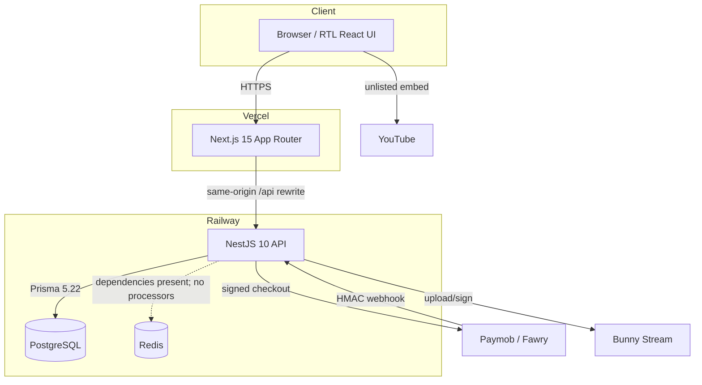

# Architecture — Learning Platform

> **Current runtime architecture, verified 28 October 2026 after migration #8 and the hardening/retakes release.** This replaces the older aspirational architecture notes. For exact release/test facts see [`CURRENT-STATE.md`](CURRENT-STATE.md). For deployment steps see [`DEPLOY.md`](DEPLOY.md).

## 1. System shape



- **Web:** Next.js 15, React 19, App Router, RTL-first.
- **API:** NestJS 10 modular monolith, global prefix `/api`.
- **DB:** PostgreSQL + Prisma, shared schema with `tenantId` on every tenant-owned row.
- **Cache/jobs:** Redis and Bull dependencies exist, but no processors are registered.
- **Deploy:** Vercel (web) + Railway (API/PostgreSQL), root `Dockerfile` for the API.

## 2. Modules

`apps/api/src/modules/` contains 13 domain modules:

| Module | Responsibility |
| --- | --- |
| `tenants` | Host resolution, tenant config, Prisma tenant-context proxy |
| `auth` | Login/register, JWT access cookie, rotating refresh sessions, cookie policy |
| `authorization` | Policy engine, guards, `@RequirePermission` |
| `users` | Profiles and user administration |
| `courses` | Courses, sections, lessons, resources, assignments, exams, progress, progression, public/student views, publishing |
| `entitlements` | Resource access grants/checks, separate from feature flags |
| `feature-flags` | Tenant/plan feature toggles |
| `plans` | Plans and subscriptions |
| `payments` | Orders, intents, providers, ledger, refunds, webhooks, idempotency |
| `video` | Video records, provider abstraction, YouTube attach, upload/signing |
| `video-protection` | Signed playback tokens, watermark engine, playback sessions |
| `audit` | Audit and security event writes |
| `outbox` | Transactional event rows (no dispatcher) |

The `courses` module contains subfolders for assignments, exams, lessons, resources, enrollments, progress, and progression; they are not separate top-level Nest modules.

The module list is the source of truth; older diagrams that show a separate AI/RAG service inside this repo are inaccurate. The SANAD evaluation call is an HTTP client to an external service.

## 3. Request lifecycle

```text
Request
  → Next.js page/rewrite
  → TenantResolverMiddleware
      host → tenant_domains lookup (SECURITY DEFINER)
      → AsyncLocalStorage tenant scope
  → ClientIpThrottlerGuard (deployed; health/webhooks skip)
  → JwtAuthGuard (access cookie)
  → AuthorizationGuard + @RequirePermission
  → Controller/DTO validation
  → Domain service
      → PrismaService extended client
          → short transaction
          → set_config('app.tenant_id', <id>, true)
          → query/update
      → audit/outbox writes (same transaction where required)
  → JSON response
```

### Tenant resolution details

- Host is taken from the `Host` header; the port is stripped.
- `health` and `ready` are exempt.
- The lookup uses `app_resolve_tenant_by_domain`, a `SECURITY DEFINER` function, because the request has no tenant context yet.
- Resolved tenant ids are cached briefly in the middleware; the tenant context is still set per request.
- JWT `tenantId` is checked against the host-resolved tenant. A mismatch is rejected.

### Prisma tenant context

`PrismaService` returns an extended client. Each operation runs inside a short transaction with `set_config(..., true)` so the setting cannot leak through connection pooling.

Interactive `$transaction` callbacks are not automatically wrapped; those sites call `applyTenantContext(tx)` explicitly.

### RLS status

The database side is installed:

- 8 production migrations (migration #8 applied 28 October 2026);
- 43 application tables;
- 138 policies;
- `FORCE ROW LEVEL SECURITY` on application tables;
- `app_user` role created by the bootstrap.

The runtime side is **not active** on Railway yet: `PrismaService` selects `MIGRATION_DATABASE_URL` before `DATABASE_URL`, and the deployed service uses the migration/owner URL. A table owner with `FORCE` still obeys RLS, but a superuser bypasses it; in either case the intended non-owner role is not in use.

**Therefore:** application-level `tenantId` filters are still required on every query. See `docs/DEPLOY.md` for activation.

## 4. Data model

43 Prisma models, grouped:

| Group | Models |
| --- | --- |
| Tenancy | `Tenant`, `TenantDomain`, `TenantConfig` |
| Identity | `User`, `Device`, `Session` |
| Content | `Course`, `Section`, `Lesson`, `Resource`, `Video` |
| Learning | `Enrollment`, `LessonProgress`, `StudentLessonUnlock`, `Assignment`, `AssignmentSubmission`, `Exam`, `ExamQuestion`, `ExamAttempt` |
| Access | `Entitlement`, `Subscription` (feature flags are stored in tenant/plan config; there is no separate `FeatureFlag` model) |
| Money | `Order`, `OrderItem`, `PaymentIntent`, `Payment`, `PaymentAttempt`, `Refund`, `LedgerEntry`, `Voucher`, `VoucherRedemption`, `Settlement`, `SettlementItem`, `ReconciliationRun`, `ReconciliationItem`, `PaymentRiskEvent`, `PaymentAuditLog` |
| Platform | `AuditLog`, `SecurityEvent`, `OutboxEvent`, `WebhookEvent`, `IdempotencyKey` |
| Video | `PlaybackSession`, `CaptureEvent` |

Enums are Prisma enums and are used as TypeScript enums (no string unions for domain states).

Money columns are stored in minor units and serialized as strings. The global JSON patch in `apps/api/src/common/serialization/json.ts` prevents `BigInt` serialization failures.

## 5. Auth and sessions

- Password hashing: Argon2id.
- Access token: JWT, 15 minutes by default, delivered in an HttpOnly cookie.
- Refresh token: 32 random bytes, opaque, HttpOnly cookie, hashed at rest, rotated on use.
- The SPA keeps only the access token in React memory.
- On mount, `AuthProvider` calls `POST /api/auth/refresh` and then `GET /api/users/me`; protected routes wait for `ready`.
- Logout revokes the refresh family and clears cookies.
- CSRF: origin-checking guard for browser mutations; `ALLOWED_ORIGINS` is required in production.
- JWT `tenantId` is bound to the request host tenant.

### Rate limiting (deployed)

`ClientIpThrottlerGuard` is registered as an `APP_GUARD`. It keys on the first `X-Forwarded-For` address (falling back to `X-Real-IP`, then the socket address), because Railway/Vercel terminate TLS in front of the API. The default ceiling is 120 requests/minute per route; the auth controller narrows login to 10/min, register to 5/min, and refresh to 30/min. Health/readiness and provider webhooks are exempt. Storage is in-memory per API instance until a shared store is wired.

## 6. LMS domain

### Content

`Course → Section → Lesson → Resource`. Lessons can be `VIDEO`, `EXAM`, or `ASSIGNMENT`. Publishing changes the current row; there is **no separate content version/snapshot table yet**, so old attempts are not guaranteed to point at an immutable content version.

### Attempts

Assignment and exam timers are server-owned, but the two models differ:

- **Assignment:** starting creates an `AssignmentSubmission` with status `IN_PROGRESS`, `startedAt = now`, and `submittedAt = null`. `expiresAt` is derived (`startedAt + timerMinutes`) and is not stored in a column. Each attempt is unique on `(assignmentId, studentId, attemptNumber)`; `maxAttempts` is enforced server-side and concurrent duplicate starts return `409`. Submitting sets `submittedAt`; in-progress rows are excluded from teacher grading. Production runs migration #8 and the attempt model; the 28 October smoke verified attempts 1 and 2 and a rejected third start at `maxAttempts=2`.
- **Exam:** `ExamAttempt.startedAt` is the timer start. `expiresAt` is derived (`startedAt + timerMinutes`) and is not stored in a column.
- The UI only displays remaining time; refresh does not extend it.
- Expiration is computed server-side. The exam client auto-submits at zero; the API records a late submit as `TIMED_OUT`. No background auto-submit worker is registered.
- Submissions are idempotent.

Default durations: assignments **300 minutes**, exams **70 minutes**.

### Progression

Active rules:

```text
ENTER_ASSIGNMENT → unlock the linked exam lesson for that student
ENTER_EXAM       → unlock the next lesson for that student
```

`StudentLessonUnlock` has a unique `(tenantId, userId, lessonId)` constraint. The grants are written in one transaction with `createMany` + `skipDuplicates`, so retries are idempotent. The enter response includes the resulting `unlocked` state.

Future unlock types are not active. Production redacts videos/assessment payloads from locked lesson responses and makes the student assignment/exam view and enter endpoints return `403 LESSON_LOCKED` unless a per-student grant exists. The lock card was verified in production in dark and light themes.

## 7. Payments

```text
Order
  → PaymentIntent (idempotent)
  → Provider (Paymob / Fawry / voucher)
  → PaymentAttempt / Payment
  → LedgerEntry (double-entry)
  → Entitlement
  → OutboxEvent
```

Key invariants:

- Every financial mutation has an idempotency key.
- The provider call is preceded by a CAS claim (`PENDING → PROCESSING`).
- Settlement uses a CAS transition and one transaction for payment/order/ledger/entitlement/outbox.
- Webhooks verify the provider signature before state change and retain the raw payload.
- Replays are deduplicated by provider event id.
- A paid event without a `PROCESSING` intent fails visibly as `INTENT_NOT_FOUND`; retry is explicit.
- Refunds claim the key before validation, reverse ledger entries, revoke only the matching entitlement, and restore voucher redemption where applicable.
- `SECOND_CHARGE_DETECTED` is raised for a second paid transaction on a settled order; no automatic double settlement.

Paymob and Fawry are implemented. Instapay, Vodafone Cash, and e&money are scaffolding, not live methods.

## 8. Video

- `VideoProvider` abstraction with Bunny Stream implementation; VdoCipher is an explicit stub.
- Teacher can attach an unlisted YouTube id; the demo uses this path.
- Student player uses the YouTube IFrame API with `youtube-nocookie.com`.
- Signed playback token: HMAC, default 5 minutes.
- Watermark engine: deterministic positions + HMAC payload.
- Playback sessions and capture events are modeled.
- The provider webhook HTTP route is absent. Bunny's webhook verification helper is not exposed.

Do not describe the platform as DRM-complete. It is a layered deterrent plus provider controls, not unbreakable DRM.

## 9. Frontend

- 35 App Router pages.
- Student area: dashboard, courses, course curriculum, lessons, assignments, exams, profile.
- Teacher area: dashboard, analytics, courses/builder/preview/publish, lessons, assignments, exams, grading, students, payments, settings.
- Public: landing, teachers, teacher space, course catalog and course detail, login, signup.
- Global providers: `ThemeProvider`, `CommandPaletteProvider`, `AuthProvider`, `LangProvider`.
- Theme: dark default; light is `html[data-theme="light"]`; key `sanad:theme`; pre-paint script in `app/layout.tsx`.
- Design system: `@lp/design-system` tokens are imported in `app/layout.tsx`; component styling for the student redesign lives in `app/globals.css` (`lc-*` surfaces).

### Student curriculum / lesson design

The October 2026 redesign replaced the old “cards on a dark stage” course page with a manuscript-like curriculum:

- a course hero with real progress and task counts;
- section/lesson rows with explicit task chips (video, assignment, exam);
- locked/available states derived from the API;
- a lesson workspace with a cinematic player, lesson rail, and task brief;
- direct links into the assignment/exam runner;
- light and dark parity, RTL-first spacing, and mobile layouts.

No mock data is allowed in these surfaces. Every count and state comes from the API.

## 10. Deployment

| Layer | Platform | Notes |
| --- | --- | --- |
| Web | Vercel | `main` production branch; `/api/*` rewrite to Railway |
| API | Railway | root `Dockerfile`; `railway.json` `DOCKERFILE` builder; `nixpacks.toml` fallback |
| DB | Railway PostgreSQL | 7 migrations applied in production (8 on the retakes branch); runtime currently owner/superuser |
| Redis | Railway | dependency present; no jobs registered |

Vercel fail-safes:

- `next.config.mjs` defaults `API_PROXY_TARGET` to the Railway API on Vercel, `http://localhost:3002` locally.
- `app/lib/api.ts` defaults the browser to same-origin, the server to the production origin on Vercel.

## 11. Known architectural gaps

1. RLS runtime activation.
2. Outbox dispatcher.
3. Video webhook route.
4. Background job processors.
5. Persisted word-level review evidence.
6. Provider sandbox verification.
7. Reconciliation worker.
8. Distributed rate limiting (current limits are in-memory per instance).
9. Railway API auto-deploy (the 28 October release was manual).
10. CI workflow verification (local evidence is authoritative for the 28 October release).
11. SETH-9 advanced controls remain roadmap-only; see [`SETH-9-ROADMAP.md`](SETH-9-ROADMAP.md).

These are tracked with acceptance criteria in [`STATUS.md`](STATUS.md) and [`CURRENT-STATE.md`](CURRENT-STATE.md).
